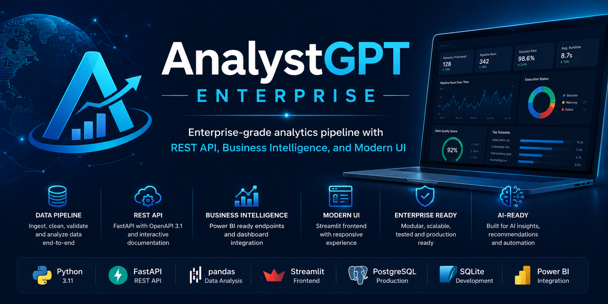
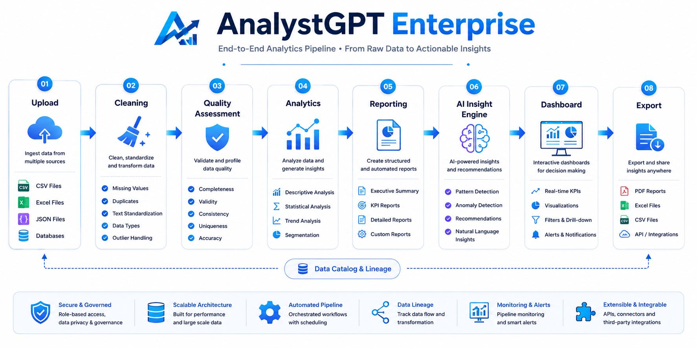
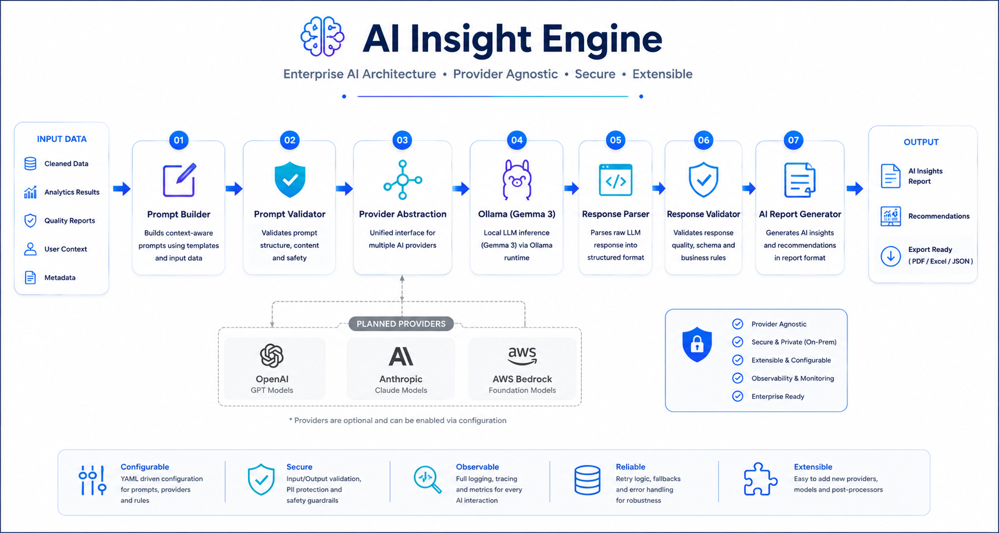
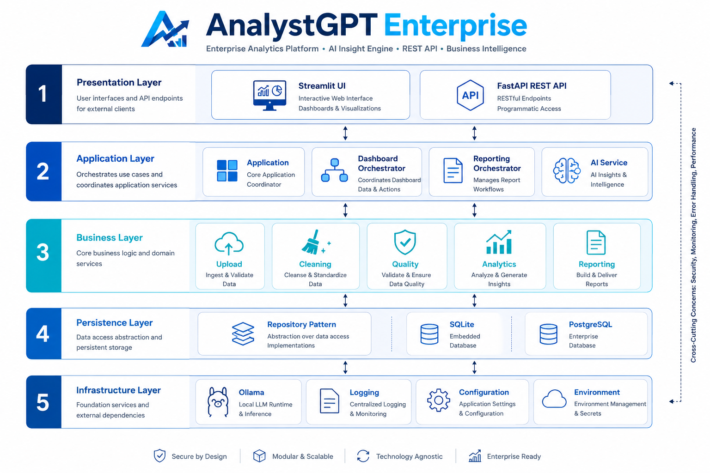

<p align="center">
  
</p>

<h1 align="center">AnalystGPT Enterprise</h1>

<p align="center">
  <strong>A governed analytics platform that turns raw datasets into validated statistics,<br>
  publication-grade reports and grounded AI insights — behind a secure, multi-user REST API.</strong>
</p>

<p align="center">
  
  
  
  
  
  
  <br>
  
  
  
  
</p>

<p align="center">
  <a href="#-quick-start">Quick start</a> ·
  <a href="#-how-it-works">How it works</a> ·
  <a href="#-rest-api">REST API</a> ·
  <a href="#-architecture">Architecture</a> ·
  <a href="#-quality--testing">Quality</a> ·
  <a href="#-roadmap">Roadmap</a> ·
  <a href="#-documentation">Docs</a>
</p>

---

## Why AnalystGPT Enterprise

Most "AI analytics" tools hand a spreadsheet to a language model and hope. AnalystGPT
Enterprise does the opposite: **every number is computed deterministically first**, cleaning is
**reviewed and traceable**, and the model only ever *interprets* statistics it is given — then
its output is checked against them.

| | |
|---|---|
| 🧮 **Deterministic first** | Upload → Cleaning → Quality → Analytics → Reporting runs and persists before any AI is involved. An AI failure never fails a pipeline run. |
| 🛡️ **Governed data** | Immutable raw dataset versions (SHA-256), explicit cleaning policies, a non-destructive preview, before/after quality metrics and end-to-end lineage. |
| 🤖 **Grounded AI** | Privacy-safe aggregated context (never raw rows), deterministic statistical wording, and a validator that flags contradicted or unsupported claims. |
| ⚡ **Asynchronous AI** | AI generation runs as a persisted background job — `PENDING → GENERATING → READY / FAILED / CANCELLED` — with polling, cancel and retry; a job keeps its input and resumes after a restart. Results appear immediately; insights follow. |
| 🔐 **Multi-user by design** | PBKDF2-HMAC-SHA256 passwords, signed bearer tokens with revocation, `ADMIN` / `ANALYST` / `VIEWER` roles, login lockout, a hash-chained audit log, and per-user isolation enforced and tested on every resource route. |
| 📄 **Publication-grade output** | Multi-page PDF and text reports with charts, KPI summaries, governance tables and lineage cards; Power BI-ready endpoints. |

---

## 🚀 Quick start

**Prerequisites:** Python 3.11+. Optional: [Ollama](https://ollama.com) with `gemma3:4b` for AI
insights, Docker for the full stack.

### Option A — Docker Compose (full stack)

```bash
git clone https://github.com/amaljosekichu66-sketch/AnalystGPT_Enterprise.git
cd AnalystGPT_Enterprise
cp .env.example .env            # REQUIRED: set AUTH_SECRET_KEY (compose runs in production
                                # and refuses to start without a >= 32-byte key)
docker compose up -d --build
docker compose exec api python scripts/create_admin.py --username admin --email admin@example.com
```

| Service | URL |
|---|---|
| Streamlit UI | http://localhost:8501 |
| REST API (Swagger) | http://localhost:8000/docs |
| Health | http://localhost:8000/api/health |

PostgreSQL runs as an internal service and is not exposed on a host port.

### Option B — Local development

```bash
git clone https://github.com/amaljosekichu66-sketch/AnalystGPT_Enterprise.git
cd AnalystGPT_Enterprise
python -m venv venv
source venv/bin/activate        # Windows: .\venv\Scripts\Activate.ps1
pip install -r requirements-dev.txt
cp .env.development.example .env   # SQLite + development mode (.env.example is for deployments)

uvicorn src.api.server:app --reload            # API  → http://127.0.0.1:8000/docs
streamlit run src/frontend/streamlit_app.py    # UI   → http://localhost:8501
python main.py --owner <user> sample_data/customer_data.csv   # CLI (python main.py --help)
```

For AI insights, run Ollama locally and pull the default model:

```bash
ollama pull gemma3:4b
```

Full, platform-specific commands (including Windows PowerShell) are in the
[Developer Runbook](docs/development/DEVELOPER_COMMANDS.md).

---

## 🔍 How it works

<p align="center">
  
</p>

```text
 Upload ──► Profiling ──► Governance ──► Cleaning ──► Quality ──► Analytics ──► Reporting ──► Persist
 CSV/XLSX    semantic      policy +        applied      before /     stats,        PDF / TXT      runs,
 JSON        types, roles  preview,        policy       after        correlation,  exports,       reports,
             (PII-aware)   versioning                   metrics      distribution  Power BI       lineage
                                                                                         │
                                                        background AI job ◄──────────────┘
                              PENDING → GENERATING → READY / FAILED / CANCELLED   (polled by the UI)
```

1. **Upload & profile** — files are ingested and stored as an immutable dataset version; the
   semantic profiler separates domain meaning (identifier, postal code, contact field, measure,
   dimension…) from pandas dtypes, so a postal code is never charted as a number.
2. **Govern & clean** — cleaning policies are explicit and versioned; a non-destructive preview
   shows the effect before execution; a non-default policy is proposed, reviewed and approved
   before a run may use it; and every execution records rows removed, columns changed and
   quality before vs. after.
3. **Analyse & report** — descriptive, numerical, categorical, correlation and distribution
   analysis feed a report with a planned, bounded chart set (4–8 charts).
4. **Interpret** — an asynchronous job builds a privacy-safe `AIDataContext`, serializes the
   statistics with authoritative wording, calls the configured LLM, and validates the result.

---

## 🤖 AI Insight Engine

<p align="center">
  
</p>

| Stage | Component | What it guarantees |
|---|---|---|
| Context | `context_builder.py` → `AIDataContext` | Aggregated, tenant-scoped statistics and data-quality metadata — no raw rows reach the model. |
| Wording | `statistical_interpretation.py` | Skewness and kurtosis described deterministically and correctly; identifier-like columns flagged. |
| Serialization | `ReportSerializer`, `PromptBuilder` | Category cardinality kept distinct from frequency; explicit anti-hallucination rules. |
| Provider | `BaseLLM` → `LLMFactory` → `OllamaClient` | Engines depend only on the interface; the provider is configuration-driven (`LLM_PROVIDER`). |
| Engines | `AIManager` → `UnifiedReportEngine` | One LLM request returns the executive summary, recommendations, explanations and narrative. |
| Validation | `insight_validator.py` | Contradictions and unsupported conclusions recorded on the report's `limitations`, never silently dropped. |
| Lifecycle | `AIJobService`, `AIJobExecutor` | Persisted state machine, atomic claim, retry, stale-job recovery. |

**Current provider:** Ollama (`gemma3:4b`, local inference).
**Planned (Sprint 16):** Google Cloud / Gemini behind the same interface, with a clean path for
further adapters such as Groq.

---

## 🌐 REST API

The API is the single contract for every client — Streamlit today, React later, Power BI
alongside. All functional routes live under `/api`; the contract is frozen in
[`docs/api/openapi.json`](docs/api/openapi.json) (OpenAPI 3.1 — 46 paths, 49 operations, 51 component schemas; regenerated by
`python scripts/export_openapi.py` and diff-checked in CI).

| Area | Endpoints |
|---|---|
| **System** | `GET /` · `GET /api/health` · `GET /api/version` |
| **Authentication** | `POST /api/auth/register` (creates a `VIEWER`) · `POST /api/auth/login` · `GET /api/auth/me` · `POST /api/auth/logout` · `POST /api/auth/logout-all` · `POST /api/auth/password` |
| **Datasets** | `POST /api/datasets` (multipart upload → `dataset_version_id`) · `GET /api/datasets/{dataset_version_id}/analysis` · `DELETE /api/datasets/{dataset_version_id}` |
| **Pipeline** | `POST /api/pipeline` (takes a `dataset_version_id` and an optional APPROVED `cleaning_policy_proposal_id`) |
| **Governance** | `POST /api/governance/preview` · `GET /api/governance/dataset-versions` · `GET /api/governance/dataset-versions/{version_id}` · `GET /api/governance/lineage/run/{pipeline_run_id}` |
| **Cleaning policies** | `POST` / `GET /api/governance/policies` · `PATCH /api/governance/policies/{proposal_id}` · `POST /api/governance/policies/{proposal_id}/approve` · `POST /api/governance/policies/{proposal_id}/reject` |
| **AI Insights** | `GET /api/ai/jobs/{job_id}` · `GET /api/ai/jobs/latest/status` · `POST /api/ai/jobs/{job_id}/retry` (FAILED / CANCELLED) · `POST /api/ai/jobs/{job_id}/cancel` |
| **Reports** | `GET /api/reports` · `GET /api/reports/{report_id}/export/{text\|pdf}` · `GET /api/reports/export/{text\|pdf}` and `GET /api/reports/latest/export/{text\|pdf}` (latest) |
| **Power BI** | `GET /api/powerbi/{dashboard,status,summary,statistics,correlation,distribution,categorical,report,pipeline}` — all authenticated |
| **Administration** (`ADMIN`) | `GET /api/admin/users` · `GET` / `PATCH` / `DELETE /api/admin/users/{user_id}` · `POST /api/admin/users/{user_id}/unlock` · `GET /api/admin/audit-events` · `GET /api/admin/audit-events/verify` (hash-chain check) |

No endpoint accepts a server file path: datasets arrive as uploaded bytes and are addressed by the
server-issued `dataset_version_id`. Self-registered accounts are `VIEWER`s; an admin promotes
them with `PATCH /api/admin/users/{user_id}`.

### Example

```bash
# Log in and capture the token
TOKEN=$(curl -s -X POST http://127.0.0.1:8000/api/auth/login \
  -H "Content-Type: application/json" \
  -d '{"username": "<USERNAME>", "password": "<PASSWORD>"}' | jq -r '.access_token')

# Upload the dataset (bytes, never a server path) and keep the server-issued id
DATASET_ID=$(curl -s -X POST http://127.0.0.1:8000/api/datasets \
  -H "Authorization: Bearer $TOKEN" \
  -F "file=@sample_data/customer_data.csv" | jq -r '.dataset_version_id')

# Run the pipeline — returns results immediately, plus the AI job to poll
curl -s -X POST http://127.0.0.1:8000/api/pipeline \
  -H "Authorization: Bearer $TOKEN" -H "Content-Type: application/json" \
  -d "{\"dataset_version_id\": \"$DATASET_ID\"}" | jq '{success, execution_time, ai_job_id, ai_job_status}'

# Poll the AI job, then download the PDF report
curl -s http://127.0.0.1:8000/api/ai/jobs/<AI_JOB_ID> -H "Authorization: Bearer $TOKEN" | jq .
curl -s -o report.pdf http://127.0.0.1:8000/api/reports/export/pdf -H "Authorization: Bearer $TOKEN"
```

Interactive docs: **Swagger** `/docs` · **ReDoc** `/redoc` · full reference in
[API_REFERENCE.md](docs/api/API_REFERENCE.md).

---

## 🏗️ Architecture

<p align="center">
  
</p>

| Layer | Responsibility | Where |
|---|---|---|
| **Presentation** | Streamlit views and components; talks to the backend only over HTTP | `src/frontend/` |
| **API** | Routing, validation, auth dependencies, error handling | `src/api/` |
| **Application** | Orchestration — `Application.run()`, dashboard and reporting orchestrators | `src/application/` |
| **Business** | Upload, cleaning, quality, analytics, reporting, profiling, governance | `src/upload/` … `src/governance/` |
| **AI** | Unified report engine, job lifecycle, context, validation, provider abstraction | `src/ai/`, `src/llm/` |
| **Identity** | Users, hashing, tokens, RBAC, audit | `src/identity/` |
| **Persistence** | Repositories over a database abstraction (SQLite / PostgreSQL) | `src/persistence/`, `src/database/` |
| **Integrations** | Power BI dashboard service | `src/integrations/` |
| **Core** | Configuration, constants, logging, exceptions — imported by all, imports none | `src/core/` |

**Rules the codebase enforces:** dependencies point inward; `src/frontend` imports nothing from
`src/application`, `src/persistence`, `src/profiling` or any other backend package except
`src/core` and the upload guards (an AST test, `tests/frontend/test_frontend_boundaries.py`,
enforces it), so the Streamlit client talks to the backend only over HTTP; per-user isolation is
enforced and tested on every resource route; architectural changes are recorded as
[ADRs](docs/adr/).

<details>
<summary><strong>Project structure</strong></summary>

```text
AnalystGPT_Enterprise/
├── src/
│   ├── api/            # FastAPI app, routes, schemas, dependencies, exception handlers
│   ├── application/    # Application.run() and orchestrators
│   ├── upload/ cleaning/ quality/ analytics/ reporting/
│   ├── profiling/      # Semantic data profiling
│   ├── governance/     # Cleaning policies, preview, governance service
│   ├── storage/        # Immutable artifact store
│   ├── ai/  llm/       # Insight engine, async jobs, provider abstraction
│   ├── identity/       # Authentication, RBAC, user service
│   ├── persistence/  database/
│   ├── integrations/   # Power BI
│   ├── frontend/       # Streamlit: views, components, services, config
│   └── core/           # Config, constants, logging, exceptions, PII rule
├── tests/              # pytest suite mirroring src/; live Ollama / PostgreSQL tests marked `integration`
├── docs/               # adr/ api/ deployment/ development/ engineering/ project/ sprints/
├── performance/        # Benchmarks and performance reports
├── scripts/            # create_admin, export_openapi, make_live_sample, purge_ownerless_data,
│                       # build_requirements_lock, gemma_benchmark, lint.ps1, run_tests.ps1
├── sample_data/        # Example datasets
├── Dockerfile  docker-compose.yml  pyproject.toml  requirements*.txt  requirements.lock
├── .env.development.example   # local development (cp to .env)
├── .env.example                # production template; its CHANGE_ME key is refused
├── main.py             # CLI entry point
└── LICENSE
```

</details>

---

## ✅ Quality & testing

| Gate | Command | Result |
|---|---|---|
| Test suite | `pytest -q` | 1,242 tests in the default suite; coverage gate `fail_under = 85` |
| Lint | `flake8 src tests main.py` | blocking in CI |
| Format | `black --check src tests main.py` | blocking in CI |
| Imports | `isort --check src tests main.py` | blocking in CI |
| Types | `mypy src main.py` | blocking in CI |
| Dead code | `vulture src main.py scripts vulture_whitelist.py --min-confidence 60` | blocking in CI |

16 further tests are marked `integration` and deselected by default; they need a live Ollama
server with `gemma3:4b` — run them with `pytest -m integration`. Six PostgreSQL 16 tests
(schema 4, concurrency 2) are also `integration`-marked; they are skipped unless the
`TEST_POSTGRES_*` variables point at a throwaway database, and CI runs them in its `postgres` job.
A recorded live-Ollama run against the synthetic `sample_data/support_tickets.xlsx` (generated
by `scripts/make_live_sample.py`) is in
[docs/verification/live_ollama_run_2026-10-14.log](docs/verification/live_ollama_run_2026-10-14.log).

CI (GitHub Actions, on pushes and pull requests to `main`) runs 7 jobs: **quality** (flake8,
black, isort, mypy, vulture), **security** (gitleaks, pip-audit, bandit HIGH gate, reviewed-B608
count gate), **test** (pytest with the 85% coverage gate), **postgres** (PostgreSQL 16 schema and
concurrency integration tests), **docker-build** (API / frontend / CLI images + Trivy scan),
**compose-validation** and **compose-integration**.

Coverage spans unit, API contract, RBAC and cross-tenant isolation, concurrency, AI job
idempotency and failure isolation, export, and grounding-regression suites. The authoritative,
measured figures live in [PROJECT_STATE.md](docs/engineering/PROJECT_STATE.md) (*Headline numbers*).

---

## 🗺️ Roadmap

| Sprint | Release | Focus | Status |
|---|---|---|---|
| 0 – 13 | v0.75.0 – v13.0.0 | Foundation → pipeline → persistence → REST API → Power BI → Streamlit → AI engine → Docker/CI → identity & multi-user | ✅ Released (Sprints 0 and 0.5 were not tagged; the first tag is `v0.75.0`) |
| **14** | v14.0.0 | Enterprise Stabilization, Data Governance & Grounded Reporting | ✅ Released |
| — | v14.1.0 | Pre-Sprint-15 hardening (security, ownership, governance workflow, CI gates) | ✅ Released |
| 15 | v15.0.0 | Enterprise stabilization, governance completion & product/UX remediation | 📋 Planned |
| 16 | v16.0.0 | AI provider abstraction (Ollama + Gemini) & complete React readiness | 📋 Planned |
| 17 | v17.0.0 | React + TypeScript migration & modern presentation layer | 📋 Planned |

Each sprint starts only after the previous one is released; React work does not begin before
Sprint 17. Scope and Definitions of Done: [ROADMAP.md](docs/project/ROADMAP.md).

Sprint 15 has not started.

**Known limitations** (Sprint 15 scope): the full Upload → governance → AI workflow has not yet
been verified end-to-end through the Streamlit UI; the Dashboard overlaps the pipeline result
view. See [PROJECT_STATE.md](docs/engineering/PROJECT_STATE.md) for the full technical-debt
list.

---

## 📚 Documentation

| Document | Purpose |
|---|---|
| [PROJECT_STATE.md](docs/engineering/PROJECT_STATE.md) | Current status, executed validation, technical debt |
| [ROADMAP.md](docs/project/ROADMAP.md) | Sprint plan and Definitions of Done |
| [ARCHITECTURE.md](docs/project/ARCHITECTURE.md) | Layers, modules, data flow, dependency rules |
| [API_REFERENCE.md](docs/api/API_REFERENCE.md) · [openapi.json](docs/api/openapi.json) | REST contract |
| [DEVELOPER_COMMANDS.md](docs/development/DEVELOPER_COMMANDS.md) | Setup, run, test and quality-gate commands |
| [DEPLOYMENT_GUIDE.md](docs/deployment/DEPLOYMENT_GUIDE.md) | Docker, configuration, CI |
| [ADRs](docs/adr/) | Architecture Decision Records |
| [CHANGELOG.md](CHANGELOG.md) · [PROJECT_JOURNAL.md](docs/project/PROJECT_JOURNAL.md) | Release history and engineering journal |

---

## 🤝 Contributing

Contributions follow the project's [Definition of Done](docs/project/DEFINITION_OF_DONE.md) and
[Code Review Checklist](docs/project/CODE_REVIEW_CHECKLIST.md):

1. Branch from `main` (`feature/<name>`).
2. Keep business logic out of the presentation layer and every query user-scoped.
3. Add tests; run `pytest -q` and the five static gates (flake8, black, isort, mypy, vulture) before opening a pull request.
4. Record architectural decisions as an ADR.

---

## 📄 License

Released under the [MIT License](LICENSE).

<p align="center">
  <sub>Built by <a href="https://in.linkedin.com/in/mr-amaljose">Amal Jose</a> ·
  <a href="https://github.com/amaljosekichu66-sketch/AnalystGPT_Enterprise/issues">Report an issue</a></sub>
</p>
